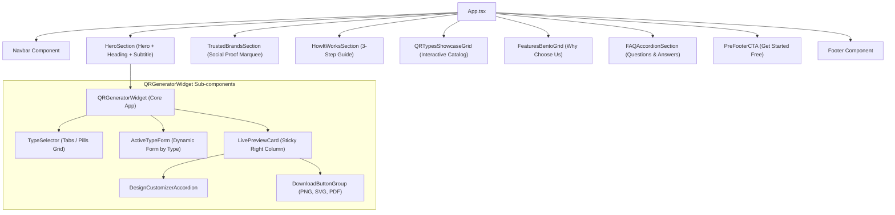
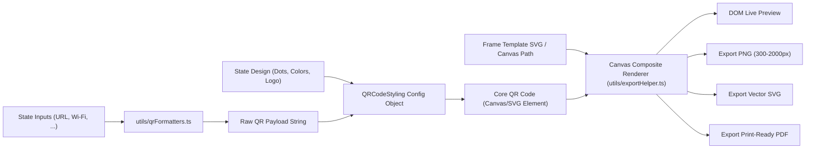
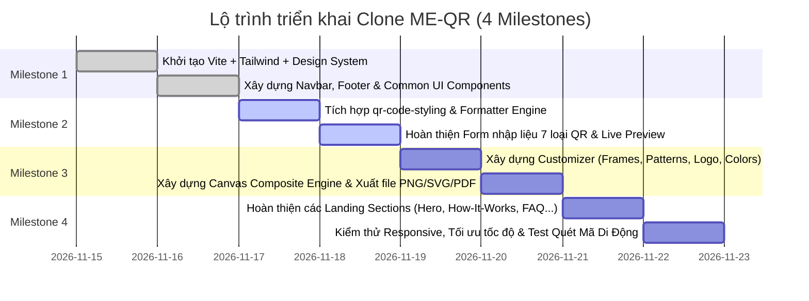

# KẾ HOẠCH TOÀN DIỆN: REVERSE-ENGINEERING & CLONE ME-QR.COM (100% CLIENT-SIDE)

> **Mục tiêu:** Xây dựng một ứng dụng web tạo mã QR hiện đại, trực quan, thẩm mỹ cao và chạy hoàn toàn 100% Client-Side (không phụ thuộc server, không quảng cáo ép buộc, không giới hạn lượt quét, không hết hạn mã), tái hiện đầy đủ trải nghiệm cao cấp của **ME-QR** (`https://me-qr.com/`).

---

## 1. BÁO CÁO TRÍCH XUẤT REA (DESIGN TOKENS & ASSETS)

### 1.1. Bảng màu chuẩn (Color System)
| Token Name | Hex Code | Tailwind Class / CSS Variable | Mục đích sử dụng |
| :--- | :--- | :--- | :--- |
| **Primary Brand** | `#0066FF` | `bg-blue-600` / `--primary` | Nút hành động chính (Generate, Download), Tab active, viền focus |
| **Primary Hover** | `#0052CC` | `hover:bg-blue-700` | Trạng thái hover của nút chính |
| **Primary Active** | `#003D99` | `active:bg-blue-800` | Trạng thái active / pressed |
| **Primary Light / Tint** | `#EFF6FF` | `bg-blue-50` / `--primary-50` | Background cho tab đang chọn, badge highlight, icon container |
| **Secondary / Teal** | `#00C4B4` | `text-teal-500` / `--accent-teal` | Điểm nhấn gradient, nhãn "Scannable", "Ready" |
| **Accent Indigo** | `#6366F1` | `bg-indigo-500` | Tag loại mã QR nổi bật, điểm nhấn thứ hai |
| **Warning / Gold** | `#F59E0B` | `text-amber-500` | Nhãn "Popular", huy hiệu tính năng đặc biệt |
| **Success Green** | `#10B981` | `text-emerald-500` | Trạng thái copied, scan test thành công |
| **Error / Alert** | `#EF4444` | `text-rose-500` | Lỗi validation (URL sai cú pháp, password trống) |
| **Surface Pure White** | `#FFFFFF` | `bg-white` | Thẻ Card, modal, khung preview QR, input background |
| **Background Light** | `#F8FAFC` | `bg-slate-50` / `--bg-light` | Màu nền toàn trang (Page background) |
| **Surface Alt / Input** | `#F1F5F9` | `bg-slate-100` | Nền cho input khi inactive, thanh tabs bar, preview background |
| **Border Light** | `#E2E8F0` | `border-slate-200` | Viền card, phân tách section, viền input mặc định |
| **Border Focus** | `#3B82F6` | `border-blue-500 ring-2 ring-blue-100` | Viền input khi focus |
| **Text Primary** | `#0F172A` | `text-slate-900` | Tiêu đề chính H1, H2, label chữ đậm |
| **Text Secondary** | `#475569` | `text-slate-600` | Đoạn văn mô tả, phụ đề, hướng dẫn |
| **Text Muted** | `#94A3B8` | `text-slate-400` | Placeholder input, chú thích nhỏ, timestamp |
| **Dark Section / Footer** | `#0F172A` | `bg-slate-900` | Background của Footer và thanh Dark CTA |
| **Footer Border** | `#1E293B` | `border-slate-800` | Đường kẻ ngang trong Footer |

#### Các Dải Gradient Đặc Trưng (Gradients)
1. **Brand Hero Gradient:** `linear-gradient(135deg, #0066FF 0%, #00C4B4 100%)` (Dùng cho logo text, nút CTA đặc biệt).
2. **Radial Hero Glow:** `radial-gradient(circle at 50% 0%, rgba(0, 102, 255, 0.08) 0%, transparent 70%)` (Nền mờ phía sau Hero section).
3. **QR Code Gradient Presets:**
   - *Ocean Blue:* `linear-gradient(135deg, #0052D4 0%, #4364F7 50%, #6FB1FC 100%)`
   - *Sunset Violet:* `linear-gradient(135deg, #8A2387 0%, #E94057 50%, #F27121 100%)`
   - *Emerald Mint:* `linear-gradient(135deg, #0BA360 0%, #3CBA92 100%)`
   - *Midnight Noir:* `linear-gradient(135deg, #141E30 0%, #243B55 100%)`

---

### 1.2. Hệ thống Typography
- **Font Gia Đình (Font Family):**
  - **Body & Controls:** `'Inter', -apple-system, BlinkMacSystemFont, 'Segoe UI', Roboto, sans-serif`
  - **Headings & Display:** `'Plus Jakarta Sans', 'Inter', sans-serif` (Bo tròn nhẹ ở nét chữ, hiện đại, thân thiện giống ME-QR).
  - **Monospace (dành cho raw code):** `'JetBrains Mono', 'Fira Code', monospace`.
- **Thang Kích Thước (Type Scale):**
  - `Hero H1`: `2.75rem - 3.5rem` (44px - 56px), Weight `800`, Line-height `1.15`, Tracking `-0.025em`.
  - `Section H2`: `2rem - 2.25rem` (32px - 36px), Weight `700`, Line-height `1.25`, Tracking `-0.02em`.
  - `Card Title H3`: `1.25rem - 1.5rem` (20px - 24px), Weight `600`, Line-height `1.3`.
  - `Body Regular`: `1rem` (16px), Weight `400` / `500`, Line-height `1.5`.
  - `Body Small / Caption`: `0.875rem` (14px), Weight `400` / `500`, Line-height `1.4`.
  - `Micro / Badges`: `0.75rem` (12px), Weight `600`, Line-height `1.2`, Tracking `0.05em`, Uppercase.

---

### 1.3. Các thông số UI đặc trưng (UI Metrics)
- **Container Max-Width:**
  - Trang chính: `max-w-7xl` (`1280px`), padding ngang `px-4 sm:px-6 lg:px-8`.
  - Hộp Widget Tạo QR: `max-w-6xl` (`1152px`).
  - Hero Content: `max-w-3xl` (`768px`).
- **Border Radius:**
  - Nhãn badge / Tab pills: `rounded-full` (`9999px`).
  - Ô input, select box, button chuẩn: `rounded-xl` (`12px`).
  - Thẻ tính năng, preset cards: `rounded-2xl` (`16px`).
  - Hộp khối QR Generator chính: `rounded-3xl` (`24px`).
- **Box Shadow System:**
  - `Card Subtle`: `0 1px 3px 0 rgba(0, 0, 0, 0.05), 0 1px 2px 0 rgba(0, 0, 0, 0.03)`
  - `Card Elevated`: `0 10px 25px -5px rgba(0, 0, 0, 0.05), 0 8px 10px -6px rgba(0, 0, 0, 0.01)`
  - `Generator Master Box`: `0 20px 40px -15px rgba(0, 102, 255, 0.08), 0 0 1px 1px rgba(0, 0, 0, 0.05)`
  - `QR Live Preview Box`: `0 15px 30px -10px rgba(0, 0, 0, 0.12), 0 0 0 1px rgba(0, 0, 0, 0.04)`

---

### 1.4. Danh mục Icons, Logo và QR Frame Templates
1. **Brand Logo:**
   - Biểu tượng khung QR cách điệu phối hợp tia quét năng động, đi cùng typography chữ "ME-QR" in hoa dày dặn, chữ "ME" màu xanh dương `#0066FF`, chữ "-QR" màu đen hoặc xám than `#0F172A`.
2. **Hệ Thống Icons (Lucide-react tương đương):**
   - *Loại QR:* `Globe` (URL), `Wifi` (Wi-Fi), `Contact` (vCard), `FileText` (Văn bản), `Mail` (Email), `MessageSquare` (SMS), `Calendar` (Sự kiện), `Share2` (Mạng xã hội), `Image` (Ảnh), `FileDown` (PDF).
   - *Công cụ & Điều khiển:* `Sparkles` (Tự động thiết kế), `Palette` (Màu sắc), `Sliders` (Tùy biến hình dạng), `Upload` (Tải logo), `Download` (Tải về), `Copy` (Sao chép), `Check` (Hoàn thành), `RefreshCw` (Làm mới), `Info` (Hướng dẫn).
3. **Danh Sách 8 Mẫu Khung (QR Frame Templates):**
   - `none`: Mã QR thuần túy không khung viền.
   - `badge-top`: Khung có bảng chữ nổi ở trên đỉnh (mặc định "SCAN ME" hoặc tùy chỉnh văn bản).
   - `badge-bottom`: Khung viền vi tính có băng chuyền văn bản ở chân đáy ("SCAN ME", "CONNECT WI-FI", "VISIT US").
   - `phone-mockup`: Khung mô phỏng viền điện thoại thông minh (smartphone bezel kèm loa thoại và thanh gạt).
   - `speech-bubble`: Khung bong bóng đối thoại có mũi tên trỏ vào mã QR.
   - `polaroid-card`: Khung ảnh polaroid cổ điển với khoảng trống chú thích ở đáy.
   - `ticket-coupon`: Khung vé giảm giá với đường đục lỗ zigzag hai cạnh bên.
   - `circular-badge`: Khung viền tròn bo cong thanh thoát có vòng đệm chữ bao quanh.

---

## 2. PHÂN TÍCH KIẾN TRÚC GIAO DIỆN (COMPONENT TREE)



### 2.1. Chi tiết từng Section từ trên xuống dưới

#### 1. Header & Navigation (`Navbar.tsx`)
- **Layout:** Flex container `h-20 items-center justify-between border-b border-slate-100 bg-white/95 backdrop-blur-md sticky top-0 z-50`.
- **Thành phần:**
  - Cột trái: Logo SVG + Brand Name.
  - Cột giữa (Desktop): Navigation links (`QR Generator`, `Solutions`, `Pricing`, `API`, `FAQ`). Hiệu ứng hover đổi màu text sang `text-blue-600` kèm đường gạch chân mượt mà.
  - Cột phải: Bộ chọn ngôn ngữ (Dropdown), Nút "Sign In" (dạng text ghost button), Nút "Create QR Code" (Button màu xanh chính).
- **Mobile Responsive:** Nút Hamburger kích hoạt Drawer menu trượt từ cạnh phải, chứa đầy đủ danh mục link và CTA.

#### 2. Hero & Khu vực Generator trung tâm (`HeroSection.tsx`)
- **Layout:** Flex column `items-center text-center pt-12 pb-20 relative overflow-hidden bg-gradient-to-b from-blue-50/40 via-white to-slate-50`.
- **Thành phần:**
  - Pill badge: `✨ 100% Free • No Sign-up Required • Unlimited Scans`.
  - Heading H1: "Free QR Code Generator Online".
  - Subheading: "Tạo, tùy biến và tải xuống mã QR chất lượng cao trong vài giây. Hỗ trợ đầy đủ URL, Wi-Fi, vCard, văn bản kèm khung trang trí và logo thương hiệu."
  - **Khối Widget Tạo Mã QR** (Chiếm vị trí trang trọng nhất).

#### 3. Khối Widget Tạo Mã QR (`QRGeneratorWidget.tsx`)
- **Layout:** Thẻ card nổi kích thước lớn `max-w-6xl mx-auto bg-white rounded-3xl shadow-xl border border-slate-200/80 overflow-hidden p-6 lg:p-8`.
- **Cấu trúc 2 cột Responsive:**
  - `lg:grid lg:grid-cols-12 lg:gap-8`:
    - **Cột Trái (Col 1-7 - 58%):** Bảng chọn Tab loại mã QR + Biểu mẫu nhập liệu tương ứng.
    - **Cột Phải (Col 8-12 - 42%):** Bảng xem trước trực tiếp (Live Preview Sticky) + Accordion tùy biến thiết kế (Khung, Hoa văn, Mắt QR, Logo, Màu sắc) + Nút Tải về (PNG / SVG / PDF).

#### 4. Khách hàng tin cậy / Social Proof (`TrustedBrands.tsx`)
- **Layout:** Container ngang `py-10 border-y border-slate-150 bg-white`.
- **Thành phần:** Dòng chữ "Được tin dùng bởi hơn 10.000.000+ cá nhân và doanh nghiệp trên toàn cầu", kèm theo hàng logo monochrome của các thương hiệu tiêu biểu (Google, Amazon, Spotify, Netflix, Shopify, Nike...) với hiệu ứng hover tăng độ mờ `opacity-60 hover:opacity-100 transition-opacity`.

#### 5. Hướng dẫn 3 bước đơn giản (`HowItWorks.tsx`)
- **Layout:** Grid 3 cột `md:grid-cols-3 gap-8 py-20 bg-slate-50`.
- **Thành phần:**
  - Bước 1: "Chọn nội dung" (Icon tài liệu + mô tả chọn URL, Wi-Fi, vCard).
  - Bước 2: "Tùy biến thiết kế" (Icon bảng màu + mô tả chọn khung, logo, hoa văn).
  - Bước 3: "Tải xuống & Sử dụng" (Icon tải về + mô tả xuất file SVG vector sắc nét hoặc PNG chuẩn in ấn).
  - Mỗi bước có số thứ tự tròn màu xanh nổi bật (`01`, `02`, `03`) và đường nối nét đứt tinh tế.

#### 6. Danh mục lưới các loại mã QR (`QRTypesGrid.tsx`)
- **Layout:** Grid 4 cột `sm:grid-cols-2 lg:grid-cols-4 gap-6 py-20 bg-white`.
- **Thành phần:** 8-12 thẻ đại diện cho từng loại mã (Link URL, Wi-Fi tự động kết nối, Danh bạ vCard, Văn bản thông điệp, Email phản hồi, SMS tin nhắn, Lịch sự kiện, PDF tài liệu).
- **Tương tác:** Mỗi card có nút "Tạo ngay" - khi click sẽ tự động cuộn mượt lên Generator và chọn đúng Tab tương ứng.

#### 7. Điểm nổi bật & Tính năng vượt trội (`FeaturesHighlight.tsx`)
- **Layout:** Bento-Grid phong cách hiện đại với các kích thước thẻ không đối xứng (`col-span-1`, `col-span-2`).
- **Nội dung:**
  - *Hoàn toàn bảo mật (100% Client-Side):* Dữ liệu không bao giờ bị lưu trên máy chủ ngoài.
  - *Không giới hạn & Vĩnh viễn:* Không quảng cáo chuyển hướng khó chịu, mã không có ngày hết hạn.
  - *Xuất Vector SVG siêu nét:* Sẵn sàng in ấn lên biển quảng cáo, menu khổ lớn mà không bị vỡ hạt.
  - *Kho biểu tượng & Khung phong phú:* Tùy chỉnh nhận diện thương hiệu chỉ với vài cú nhấp chuột.

#### 8. Câu hỏi thường gặp (`FAQAccordion.tsx`)
- **Layout:** Đơn cột căn giữa `max-w-3xl mx-auto py-20`.
- **Thành phần:** Accordion với animation mở mượt mà (`framer-motion` hoặc transition CSS). Trả lời các thắc mắc về tính miễn phí, cách in ấn, cách quét trên iPhone/Android, sự khác biệt giữa SVG và PNG.

#### 9. Chân trang (`Footer.tsx`)
- **Layout:** 4 cột chính trên nền tối `bg-slate-900 text-slate-400 py-16 px-6 lg:px-8 border-t border-slate-800`.
- **Thành phần:**
  - Cột 1: Logo bản tối, sứ mệnh công cụ, icon mạng xã hội.
  - Cột 2: Các loại QR phổ biến (Liên kết nhanh).
  - Cột 3: Công cụ & Giải pháp (Trình đọc mã, API tài liệu, In ấn).
  - Cột 4: Pháp lý & Điều khoản (Bảo mật, Điều khoản dịch vụ, Liên hệ).
  - Dòng bản quyền dưới cùng: "© 2026 ME-QR Clone. Hoàn toàn miễn phí & mã nguồn mở."

---

## 3. PHÂN TÍCH LOGIC WIDGET TẠO MÃ QR (STATE & CLIENT-SIDE ENGINE)

### 3.1. Danh mục các Tab loại QR và trường Input tương ứng
| Loại Tab (Type) | Icon | Các trường Input bắt buộc & tùy chọn | Chuỗi định dạng chuẩn xuất ra (Payload String) |
| :--- | :--- | :--- | :--- |
| **URL / Link** | `Globe` | - `url`: Địa chỉ trang web (Validation URL chuẩn, placeholder: `https://example.com`) | `https://example.com` |
| **Wi-Fi** | `Wifi` | - `ssid`: Tên mạng Wi-Fi<br>- `password`: Mật khẩu Wi-Fi<br>- `encryption`: Loại bảo mật (`WPA/WPA2`, `WEP`, `nopass`)<br>- `hidden`: Checkbox mạng ẩn | `WIFI:T:WPA;S:MyNetwork;P:Secret123;H:false;;` |
| **vCard (Danh bạ)** | `Contact` | - `firstName`, `lastName`<br>- `organization`, `title`<br>- `phoneMobile`, `phoneWork`<br>- `email`<br>- `website`<br>- `addressStreet`, `city`, `country` | `BEGIN:VCARD\nVERSION:3.0\nN:Doe;John\nFN:John Doe\nORG:Acme Corp\nTITLE:Developer\nTEL;TYPE=CELL:+84987654321\nEMAIL:john@acme.com\nURL:https://john.dev\nEND:VCARD` |
| **Văn bản (Text)** | `FileText` | - `text`: Nội dung văn bản tự do (Textarea hỗ trợ đếm ký tự 0/1000) | Chuỗi thô nguyên bản (`Raw string`) |
| **Email** | `Mail` | - `email`: Hộp thư người nhận<br>- `subject`: Tiêu đề thư<br>- `body`: Nội dung thư mẫu | `mailto:contact@domain.com?subject=Hello&body=My%20Inquiry` |
| **SMS** | `MessageSquare` | - `phoneNumber`: Số điện thoại nhận tin<br>- `message`: Nội dung tin nhắn SMS soạn sẵn | `SMSTO:+84987654321:Xin chao ban!` |
| **Sự kiện (Event)** | `Calendar` | - `title`: Tên sự kiện<br>- `location`: Địa điểm<br>- `startTime`, `endTime`: Ngày & giờ bắt đầu/kết thúc<br>- `description`: Ghi chú | `BEGIN:VCALENDAR\nVERSION:2.0\nBEGIN:VEVENT\nSUMMARY:Hoi Nghi\nLOCATION:Ha Noi\nDTSTART:20261120T090000Z\nDTEND:20261120T110000Z\nDESCRIPTION:Chi tiet...\nEND:VEVENT\nEND:VCALENDAR` |

---

### 3.2. Danh mục tùy chọn thiết kế ở cột Live Preview (Customizer)
1. **Khung viền (Frames):**
   - Bộ chọn 8 mẫu khung dạng thumbnail trực quan.
   - Trường nhập liệu tùy biến văn bản khung: `frameText` (Ví dụ: "SCAN ME", "QUÉT TÔI", "CONNECT WI-FI").
   - Bộ chọn màu khung: `frameColor` (Hex picker + bảng preset 8 màu).
   - Bộ chọn màu chữ khung: `frameTextColor` (`#FFFFFF`, `#000000` hoặc màu tùy chỉnh).
2. **Hình dạng hoa văn thân QR (Body Patterns):**
   - 6 kiểu hình dạng modules:
     - `square`: Hình vuông truyền thống.
     - `dots`: Chấm tròn chấm bi hiện đại.
     - `rounded`: Hình vuông bo tròn các góc.
     - `extra-rounded`: Bo tròn mạnh hình con nhộng.
     - `classy`: Các góc vát cạnh sắc nét hình kim cương.
     - `classy-rounded`: Vát cong mềm mại cao cấp.
3. **Hình dạng mắt quét (Corner Eyes):**
   - **Vành ngoài (Corners Square):** `square` (Vuông), `extra-rounded` (Bo góc tròn), `dot` (Tròn hoàn toàn).
   - **Tâm trong (Corners Dot):** `square` (Điểm vuông), `dot` (Điểm tròn).
4. **Biểu trưng ở giữa (Logo Presets & Upload):**
   - Thư viện logo có sẵn (1-click thêm ngay): Facebook, Instagram, YouTube, WhatsApp, Twitter/X, TikTok, LinkedIn, Wi-Fi, Telegram, Spotify, PayPal.
   - Tải ảnh logo riêng từ máy: Drag-and-drop file PNG/JPG/SVG, tự động chuyển đổi sang Base64 Data URL.
   - Tùy chỉnh kích thước logo: Thanh trượt tỉ lệ `imageSize` (từ 0.2 đến 0.42 nhằm đảm bảo mã luôn quét được).
   - Tùy chỉnh đệm: `margin` (0px - 15px quanh logo).
   - Xóa nền chấm phía sau logo (`hideBackgroundDots: true`).
5. **Màu sắc & Gradient (Color & Gradient Picker):**
   - Chế độ màu: **Màu đơn (Single Color)** hoặc **Màu chuyển (Gradient)**.
   - Thân QR (Dots Color): Hex picker kèm bảng màu phổ biến.
   - Tùy chọn Gradient: Loại `linear` hoặc `radial`, góc quay `rotation` (0° đến 360°), điểm màu bắt đầu (`startColor`) và kết thúc (`endColor`).
   - Màu vành mắt ngoài & tâm mắt trong: Có thể kế thừa màu thân hoặc chỉ định màu riêng biệt.
   - Màu nền (Background): Màu trắng (`#FFFFFF`), màu đơn bất kỳ hoặc chế độ Trong suốt (`transparent`).

---

### 3.3. Đề xuất Cấu trúc State tổng thể (TypeScript Interface)

```typescript
// Định nghĩa kiểu dữ liệu cho toàn bộ cấu hình mã QR
export type QRType = 'url' | 'wifi' | 'vcard' | 'text' | 'email' | 'sms' | 'event';

export type BodyDotType = 'square' | 'dots' | 'rounded' | 'extra-rounded' | 'classy' | 'classy-rounded';
export type CornerSquareType = 'square' | 'extra-rounded' | 'dot';
export type CornerDotType = 'square' | 'dot';
export type FrameId = 'none' | 'badge-top' | 'badge-bottom' | 'phone-mockup' | 'speech-bubble' | 'polaroid-card' | 'ticket-coupon' | 'circular-badge';

export interface GradientSetting {
  enabled: boolean;
  type: 'linear' | 'radial';
  rotation: number;
  startColor: string;
  endColor: string;
}

export interface QRState {
  // 1. Dữ liệu đầu vào theo từng loại
  type: QRType;
  inputs: {
    url: string;
    wifi: {
      ssid: string;
      password: string;
      encryption: 'WPA' | 'WEP' | 'nopass';
      hidden: boolean;
    };
    vcard: {
      firstName: string;
      lastName: string;
      organization: string;
      title: string;
      phoneMobile: string;
      phoneWork: string;
      email: string;
      website: string;
      addressStreet: string;
      city: string;
      country: string;
    };
    text: string;
    email: {
      email: string;
      subject: string;
      body: string;
    };
    sms: {
      phoneNumber: string;
      message: string;
    };
    event: {
      title: string;
      location: string;
      startTime: string;
      endTime: string;
      description: string;
    };
  };

  // 2. Tùy biến thiết kế trực quan
  design: {
    frame: {
      id: FrameId;
      text: string;
      frameColor: string;
      textColor: string;
    };
    dots: {
      type: BodyDotType;
      color: string;
      gradient: GradientSetting;
    };
    cornersSquare: {
      type: CornerSquareType;
      color: string;
      customColor: boolean;
    };
    cornersDot: {
      type: CornerDotType;
      color: string;
      customColor: boolean;
    };
    background: {
      color: string;
      isTransparent: boolean;
    };
    logo: {
      url: string | null;
      size: number; // 0.2 - 0.4
      margin: number; // 0 - 15
      hideBackgroundDots: boolean;
    };
  };

  // 3. Tùy chọn kích thước & xuất file
  output: {
    width: number; // 300 - 2000px
    height: number;
    errorCorrectionLevel: 'L' | 'M' | 'Q' | 'H'; // Mặc định 'Q' hoặc 'H' khi có Logo
  };
}
```

---

### 3.4. Ánh xạ State sang thư viện `qr-code-styling` & Bộ vẽ Khung (Canvas Composite Engine)



#### Phương pháp tích hợp chi tiết:
1. **Lớp lõi mã QR (Core Matrix):**
   Sử dụng thư viện `qr-code-styling` với các thông số truyền trực tiếp:
   ```typescript
   const qrCodeOptions: Options = {
     width: 320,
     height: 320,
     data: formattedPayload,
     dotsOptions: {
       type: state.design.dots.type,
       color: state.design.dots.color,
       gradient: state.design.dots.gradient.enabled ? {
         type: state.design.dots.gradient.type,
         rotation: (state.design.dots.gradient.rotation * Math.PI) / 180,
         colorStops: [
           { offset: 0, color: state.design.dots.gradient.startColor },
           { offset: 1, color: state.design.dots.gradient.endColor }
         ]
       } : undefined
     },
     cornersSquareOptions: {
       type: state.design.cornersSquare.type,
       color: state.design.cornersSquare.customColor ? state.design.cornersSquare.color : state.design.dots.color
     },
     cornersDotOptions: {
       type: state.design.cornersDot.type,
       color: state.design.cornersDot.customColor ? state.design.cornersDot.color : state.design.dots.color
     },
     backgroundOptions: {
       color: state.design.background.isTransparent ? 'rgba(0,0,0,0)' : state.design.background.color
     },
     image: state.design.logo.url || undefined,
     imageOptions: {
       hideBackgroundDots: state.design.logo.hideBackgroundDots,
       imageSize: state.design.logo.size,
       margin: state.design.logo.margin,
       crossOrigin: 'anonymous'
     },
     qrOptions: {
       errorCorrectionLevel: state.design.logo.url ? 'H' : 'Q'
     }
   };
   ```
2. **Lớp khung bao ngoài (Frame Compositing):**
   - Khi `frame.id !== 'none'`, một hàm vẽ composite trên Canvas hoặc ghép nối SVG sẽ được kích hoạt:
     - Tạo một Canvas tạm thời với kích thước mở rộng (ví dụ: `width: 400`, `height: 480`).
     - Vẽ hình khối khung (Badge header, Phone bezel, hoặc Ribbon đáy) với màu `frameColor`.
     - Vẽ chữ kêu gọi hành động `frameText` được căn lề hoàn hảo với màu `textColor` và font chữ bo tròn đậm.
     - Vẽ Canvas của mã QR vào khu vực hiển thị trung tâm của khung.
3. **Quy trình Tải file xuống 100% Client-Side:**
   - **PNG:** Gọi `compositeCanvas.toBlob((blob) => { saveAs(blob, 'me-qr-code.png'); }, 'image/png')`.
   - **SVG:** Ghép thẻ `<svg>` của mã QR vào template `<svg>` của khung, chuyển thành `Blob(['data:image/svg+xml...'])` và kích hoạt tải về.
   - **PDF:** Dùng thư viện nhẹ `jspdf` để nhúng ảnh composite vào tài liệu PDF chuẩn vector khổ A4 hoặc thẻ danh thiếp chuẩn in ấn.

---

## 4. CẤU TRÚC THƯ MỤC DỰ ÁN (PROJECT STRUCTURE)

Dự án được tổ chức theo chuẩn kiến trúc React 18+ (Vite) + TypeScript + Tailwind CSS, module hóa rõ ràng, dễ bảo trì và mở rộng:

```
clone_QR/
├── public/
│   ├── favicon.svg                   # Favicon mã QR của ứng dụng
│   ├── logos/                        # 11+ preset icons (Facebook, Instagram, WiFi, v.v.)
│   │   ├── facebook.svg
│   │   ├── instagram.svg
│   │   ├── youtube.svg
│   │   ├── whatsapp.svg
│   │   ├── x-twitter.svg
│   │   ├── tiktok.svg
│   │   ├── linkedin.svg
│   │   ├── wifi.svg
│   │   ├── telegram.svg
│   │   ├── spotify.svg
│   │   └── paypal.svg
│   └── frames/                       # Các asset vector mẫu khung
│       ├── badge-top.svg
│       ├── badge-bottom.svg
│       ├── phone-mockup.svg
│       └── speech-bubble.svg
│
├── src/
│   ├── assets/                       # Ảnh minh họa, banner
│   │   └── hero-illustration.svg
│   │
│   ├── components/
│   │   ├── common/                   # UI primitives tái sử dụng
│   │   │   ├── Button.tsx            # Nút bấm chuẩn với các biến thể (primary, outline, ghost)
│   │   │   ├── Input.tsx             # Text input kèm label và thông báo lỗi
│   │   │   ├── TextArea.tsx          # Ô nhập văn bản nhiều dòng kèm đếm ký tự
│   │   │   ├── Select.tsx            # Dropdown lựa chọn chuẩn
│   │   │   ├── ColorPicker.tsx       # Bảng chọn màu kèm danh sách preset màu thông dụng
│   │   │   ├── Slider.tsx            # Thanh trượt điều chỉnh kích thước / độ đệm
│   │   │   ├── Modal.tsx             # Hộp thoại pop-up (dành cho Download Preview)
│   │   │   └── Accordion.tsx         # Thanh đóng/mở nội dung dạng xếp lớp
│   │   │
│   │   ├── layout/                   # Bộ khung trang
│   │   │   ├── Navbar.tsx            # Thanh điều hướng trên cùng
│   │   │   ├── Footer.tsx            # Chân trang thông tin & liên kết
│   │   │   ├── Container.tsx         # Bao bọc căn giữa chuẩn `max-w-7xl`
│   │   │   └── SectionHeader.tsx     # Tiêu đề + mô tả chuẩn cho từng Section
│   │   │
│   │   ├── generator/                # Toàn bộ widget tạo mã QR cốt lõi
│   │   │   ├── QRGeneratorWidget.tsx # Khối container chính kết nối State & 2 cột
│   │   │   ├── TypeSelector.tsx      # Thanh chọn loại QR (Tab Bar / Pills)
│   │   │   ├── forms/                # Form nhập liệu riêng theo từng loại
│   │   │   │   ├── UrlForm.tsx
│   │   │   │   ├── WifiForm.tsx
│   │   │   │   ├── VCardForm.tsx
│   │   │   │   ├── TextForm.tsx
│   │   │   │   ├── EmailForm.tsx
│   │   │   │   ├── SmsForm.tsx
│   │   │   │   └── EventForm.tsx
│   │   │   ├── preview/              # Cột bên phải (Live Preview & Tùy biến)
│   │   │   │   ├── LivePreviewCard.tsx     # Thẻ chứa preview QR bám dính khi cuộn
│   │   │   │   ├── FrameSelector.tsx       # Chọn mẫu khung và đổi text khung
│   │   │   │   ├── PatternSelector.tsx     # Chọn hoa văn thân và mắt quét
│   │   │   │   ├── ColorControls.tsx       # Bộ chọn màu đơn / gradient
│   │   │   │   ├── LogoControls.tsx        # Chọn logo có sẵn hoặc upload logo riêng
│   │   │   │   └── DownloadButtonGroup.tsx # Nút tải nhanh PNG, SVG, PDF
│   │   │
│   │   └── sections/                 # Các khối nội dung của Landing Page
│   │       ├── HeroSection.tsx       # Khối chào sân kèm tiêu đề và widget
│   │       ├── TrustedBrands.tsx     # Băng chuyền đối tác tin cậy
│   │       ├── HowItWorks.tsx        # Hướng dẫn 3 bước tạo mã
│   │       ├── QRTypesGrid.tsx       # Lưới khám phá 8+ loại mã QR
│   │       ├── FeaturesHighlight.tsx # Bento-grid các tính năng nổi bật
│   │       ├── FAQSection.tsx        # Danh sách câu hỏi thường gặp
│   │       └── CTASection.tsx        # Banner kêu gọi hành động cuối trang
│   │
│   ├── data/                         # Dữ liệu tĩnh được tách biệt
│   │   ├── qrTypes.ts                # Danh sách loại QR, icon và mô tả
│   │   ├── frameTemplates.ts         # Danh sách 8 mẫu khung và thông số vẽ
│   │   ├── logoPresets.ts            # Danh sách các logo phổ biến
│   │   ├── colorPresets.ts           # Bảng màu sắc gợi ý đẹp mắt
│   │   ├── faqData.ts                # Bộ câu hỏi & câu trả lời FAQ
│   │   └── trustedBrands.ts          # Danh sách logo đối tác
│   │
│   ├── hooks/                        # Custom React Hooks
│   │   ├── useQRCode.ts              # Quản lý vòng đời và cập nhật instance `qr-code-styling`
│   │   ├── useDebounce.ts            # Trì hoãn render khi gõ phím để tối ưu hiệu năng
│   │   └── useLocalStorage.ts        # Lưu lại cấu hình thiết kế người dùng ưa thích
│   │
│   ├── types/                        # Định nghĩa TypeScript
│   │   ├── qr.types.ts               # Kiểu dữ liệu cấu hình mã QR
│   │   └── ui.types.ts               # Kiểu dữ liệu cho các component giao diện
│   │
│   ├── utils/                        # Các hàm tiện ích thuần túy (Pure functions)
│   │   ├── qrFormatters.ts           # Chuyển đổi dữ liệu form sang chuỗi payload chuẩn
│   │   ├── exportHelper.ts           # Xử lý tổng hợp Canvas và tải file PNG/SVG/PDF
│   │   └── colorHelper.ts            # Hỗ trợ tính toán độ tương phản và chuyển đổi hex
│   │
│   ├── App.tsx                       # Component chính kết hợp các section
│   ├── main.tsx                      # Điểm khởi chạy React DOM
│   └── index.css                     # Cấu hình Tailwind directives & custom animations
│
├── index.html                        # HTML entry point kèm Google Fonts
├── package.json                      # Danh sách dependencies & scripts
├── tailwind.config.js                # Mở rộng theme màu sắc và typography
├── tsconfig.json                     # Cấu hình TypeScript nghiêm ngặt
├── vite.config.ts                    # Cấu hình build tối ưu của Vite
└── CLONE_PLAN.md                     # Bản tài liệu kế hoạch chi tiết (File này)
```

---

## 5. LỘ TRÌNH TRIỂN KHAI (EXECUTION ROADMAP)

Quá trình phát triển sẽ được chia thành **4 Milestone nhỏ gọn, có kiểm thử độc lập** sau khi Kế hoạch này được người dùng duyệt:



### Chi tiết từng Milestone:

#### Milestone 1: Khởi tạo Nền tảng, Design System & Layout Shell
- [ ] Khởi tạo dự án Vite (React 18 + TypeScript + Tailwind CSS).
- [ ] Cấu hình `tailwind.config.js` mở rộng bảng màu ME-QR (`primary`, `teal`, `slate`, v.v.), typography (`Plus Jakarta Sans`, `Inter`), và box-shadow.
- [ ] Cài đặt các thư viện phụ trợ: `lucide-react` (icons), `clsx`, `tailwind-merge`.
- [ ] Xây dựng các UI Primitives dùng chung trong `components/common/`: `Button`, `Input`, `Select`, `ColorPicker`, `Accordion`.
- [ ] Hoàn thiện `Navbar` (kèm mobile drawer) và `Footer` hoàn chỉnh.
- **Tiêu chí nghiệm thu M1:** Khung giao diện chạy mượt ở `localhost:5173`, responsive hoàn hảo từ mobile (375px) đến desktop (1440px).

#### Milestone 2: Trình Tạo Mã QR Cốt Lõi & Động Cơ Định Dạng Chuỗi
- [ ] Cài đặt thư viện `qr-code-styling`.
- [ ] Xây dựng các hàm chuyển đổi chuỗi chuẩn trong `utils/qrFormatters.ts` cho URL, Wi-Fi, vCard, Text, Email, SMS, Event.
- [ ] Xây dựng `TypeSelector.tsx` cho phép chuyển đổi mượt mà giữa các tab.
- [ ] Xây dựng các form nhập liệu tương ứng trong `components/generator/forms/` với đầy đủ validation và debounce.
- [ ] Tạo Hook `useQRCode.ts` liên kết dữ liệu nhập sang instance `QRCodeStyling` để vẽ mã QR tức thì lên canvas preview.
- **Tiêu chí nghiệm thu M2:** Người dùng nhập URL hoặc mật khẩu Wi-Fi, mã QR lập tức tự động cập nhật trong vòng < 50ms; dùng camera điện thoại quét thử nghiệm thành công 100%.

#### Milestone 3: Bộ Tùy Biến Thiết Kế Trực Quan & Động Cơ Xuất File Đa Định Dạng
- [ ] Tích hợp bộ tùy chọn hoa văn thân (`dots`, `rounded`, `classy`...) và góc mắt (`square`, `dot`).
- [ ] Tích hợp bảng chọn màu đơn và bộ tạo dải màu Gradient (Linear / Radial).
- [ ] Xây dựng thư viện 11+ Logo có sẵn kèm tính năng tải ảnh logo cá nhân (drag-and-drop file, chuyển sang base64, tinh chỉnh `imageSize` và xóa chấm nền).
- [ ] Xây dựng bộ 8 mẫu khung trang trí (Frames) và logic vẽ composite trên Canvas/SVG.
- [ ] Tích hợp xuất file độ phân giải cao:
  - Tải file PNG (500px, 1000px, 2000px).
  - Tải file vector SVG gốc.
  - Tải file in ấn PDF thông qua thư viện `jspdf`.
- **Tiêu chí nghiệm thu M3:** Người dùng chọn khung "SCAN ME", đổi màu gradient, thêm logo Facebook; ảnh tải về có đầy đủ khung và logo, quét thử nghiệm trên điện thoại nhận diện chính xác.

#### Milestone 4: Hoàn Thiện Landing Page, Tối Ưu UX & Kiểm Thử Toàn Diện
- [ ] Xây dựng các Section bổ trợ:
  - `HeroSection` lôi cuốn với huy hiệu và tiêu đề chuẩn SEO.
  - `TrustedBrands` với hiệu ứng marquee hoặc grid đối tác.
  - `HowItWorks` trực quan 3 bước kèm đường nối.
  - `QRTypesGrid` danh mục 8 thẻ tương tác liên kết ngược lên form.
  - `FeaturesHighlight` Bento Grid thể hiện ưu thế 100% Client-Side.
  - `FAQAccordion` giải đáp 6-8 câu hỏi thường gặp nhất.
- [ ] Tối ưu hóa hiệu năng (Lighthouse score 95+): lazy-loading ảnh, tinh gọn bundle size.
- [ ] Kiểm thử kiểm tra tương thích trên màn hình di động, máy tính bảng và các trình duyệt (Chrome, Safari, Firefox, Edge).
- **Tiêu chí nghiệm thu M4:** Ứng dụng hoạt động độc lập, không có lỗi console, giao diện chuyên nghiệp tương đương hoặc vượt trội so với bản gốc `me-qr.com`.

---

## 6. KẾT LUẬN & ĐỀ NGHỊ BƯỚC TIẾP THEO

Bản kế hoạch trên đã khảo sát và phân tích toàn diện trang `https://me-qr.com/`, trích xuất chính xác hệ thống design tokens, bóc tách cấu trúc component phân cấp, quy hoạch luồng state máy khách 100% không cần backend, và vạch ra lộ trình 4 milestone cụ thể.

**ĐỀ NGHỊ:**
Quý người dùng vui lòng xem xét bản kế hoạch chi tiết này. Khi đã hoàn toàn hài lòng và nhấn nút **Phê duyệt (Proceed/Approve)**, chúng ta sẽ bắt đầu thực hiện **Milestone 1** (Khởi tạo dự án Vite + Tailwind + Design System nền tảng).