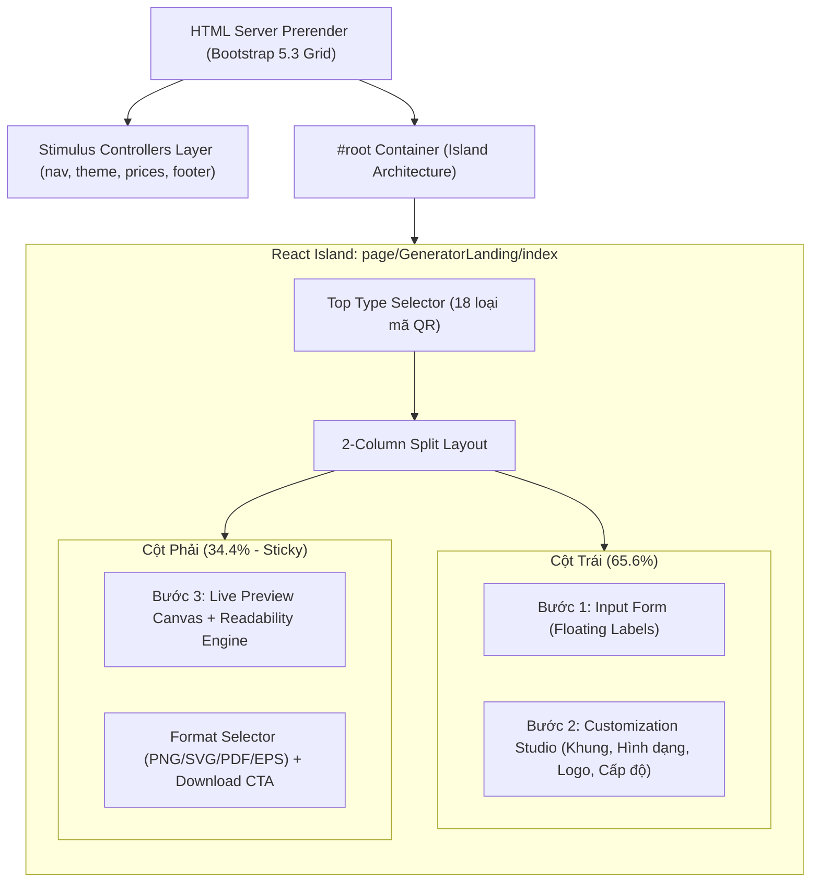
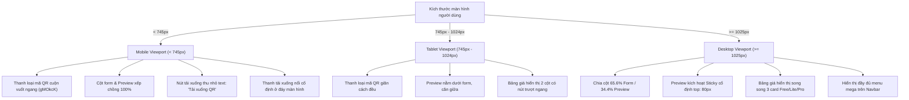

# TÀI LIỆU THIẾT KẾ & ĐẶC TẢ UX/UI TOÀN DIỆN: HỆ THỐNG ME-QR (`https://me-qr.com/vi`)

> **Phương pháp thực hiện:** Reverse-Engineering thông qua việc giải mã client bundles (`runtime.js`, `app.js`, `71996.css`), phân tích cây DOM máy chủ kết xuất (SSR/Prerender), bóc tách Stimulus Controllers, React Islands (`page/GeneratorLanding/index`), hệ thống Design Tokens Bootstrap 5.3 tùy biến và dữ liệu cấu trúc `window.__TEMPLATES_INITIAL__`.

---

## MỤC LỤC
1. [Tổng quan Kiến trúc Giao diện & Công nghệ](#1-tổng-quan-kiến-trúc-giao-diện--công-nghệ)
2. [Hệ thống Design Tokens (Màu sắc, Typography, Breakpoints, Spacing)](#2-hệ-thống-design-tokens)
3. [Header, Navigation & Thanh điều hướng Sticky](#3-header-navigation--thanh-điều-hướng-sticky)
4. [Widget Tạo Mã QR Cốt lõi (Kiến trúc 3 bước tương tác)](#4-widget-tạo-mã-qr-cốt-lõi)
   - [Bước 0: Thanh chọn danh mục loại mã QR](#bước-0-thanh-chọn-danh-mục-loại-mã-qr)
   - [Bước 1: Khối nhập liệu nội dung (Thêm nội dung)](#bước-1-khối-nhập-liệu-nội-dung-thêm-nội-dung)
   - [Bước 2: Xưởng thiết kế tùy biến (Tùy chỉnh QR)](#bước-2-xưởng-thiết-kế-tùy-biến-tùy-chỉnh-qr)
   - [Bước 3: Khối Live Preview & Xuất file (Tạo & tải QR)](#bước-3-khối-live-preview--xuất-file-tạo--tải-qr)
5. [Cấu trúc Chi tiết 15 Section trên Trang Chủ](#5-cấu-trúc-chi-tiết-15-section-trên-trang-chủ)
6. [Hệ thống Footer & Hệ sinh thái ME-Team](#6-hệ-thống-footer--hệ-sinh-thái-me-team)
7. [Hệ thống Modals & Popup Tương tác](#7-hệ-thống-modals--popup-tương-tác)
8. [Quy chuẩn Responsive & Giao diện Đa thiết bị](#8-quy-chuẩn-responsive--giao-diện-đa-thiết-bị)
9. [Cơ chế Chế độ Sáng / Tối (Dark / Light Theme)](#9-cơ-chế-chế-độ-sáng--tối-dark--light-theme)
10. [So sánh & Đề xuất Nâng cấp cho Bản Clone Client-Side](#10-so-sánh--đề-xuất-nâng-cấp-cho-bản-clone-client-side)

---

## 1. TỔNG QUAN KIẾN TRÚC GIAO DIỆN & CÔNG NGHỆ

### 1.1. Ngăn xếp Công nghệ Frontend gốc của ME-QR
- **Kiến trúc Tổng thể:** Hybrid SSR + Client-Side Hydration.
- **Micro-framework Điều phối:** Hotwired Stimulus (`data-controller`, `data-action`, `data-target`).
- **Ứng dụng Tương tác Cốt lõi:** React 18 nhúng dưới dạng Island tại `#root` (`data-react--component-path-value="page/GeneratorLanding/index"`).
- **CSS Framework & Styling:** Bootstrap 5.3 tùy biến sâu + Styled Components (`sc-*`) + CSS Variables.
- **Hệ thống Icon:** SVG Symbol Sprites (`card-type-icons.svg`, `symbol.svg`, `pricing-icons.svg`).
- **Trình nhúng hỗ trợ trực tuyến:** HelpCrunch Live Chat SDK.



---

## 2. HỆ THỐNG DESIGN TOKENS

### 2.1. Bảng màu Chuẩn (Color Palette)

| Vai trò Token | Mã Hex / Giá trị | Mô tả & Ứng dụng |
| :--- | :--- | :--- |
| **Brand Primary** | `#9b27af` | Màu tím thương hiệu ME-QR, nút bấm chính, viền active, số thứ tự bước active |
| **Brand Primary Hover** | `#c030d8` | Trạng thái hover của nút bấm chính, link tương tác |
| **Brand Primary Soft** | `#f5e7f8` | Nền nhạt cho tag, pill tab active, banner thông báo gói Premium |
| **Dark Heading / Text** | `#1a1a24` / `#212529` | Màu chữ tiêu đề H1-H6, văn bản chính |
| **Muted Gray Text** | `#727271` / `#8b929a` | Màu chữ phụ, chú thích, nhãn floating label khi chưa focus |
| **Border Neutral** | `#dde0e4` | Viền ô input, viền card, đường phân cách giữa các hàng |
| **Border Light** | `#f0f0f2` | Viền nhạt ngăn cách bảng biểu và các danh mục |
| **Light Surface** | `#ffffff` | Nền các khối thẻ card, nền generator widget |
| **Gray Background** | `#f8f9fa` / `#f5f5f5` | Nền toàn trang web (body), nền ô chọn loại chưa active |
| **Footer Dark** | `#0e0d17` / `#161522` | Nền tối chuyên biệt cho khu vực Footer và Banner Mobile App |
| **Brand Gradient (Art QR)** | `linear-gradient(to right, #4b15b2, #a20990, #ff4e51)` | Nền thẻ quảng bá "Logo QR ✨ MỚI" |
| **Accent Badge (Gold)** | `#ffc446` / `#f2cf6b` | Huy hiệu "MỚI", icon vương miện gói Pro |
| **Error / Alert** | `#d82e2a` / `#d12519` | Báo lỗi nhập liệu không hợp lệ |
| **Success / Scannable** | `#77a080` / `#507256` | Trạng thái mã QR quét được 100% |

### 2.2. Thang Typography (Type Scale)

Hệ thống typography sử dụng font hệ thống mượt mà:
`font-family: -apple-system, BlinkMacSystemFont, "Segoe UI", Roboto, "Helvetica Neue", Arial, sans-serif`

| Lớp CSS | Kích thước Font | Line Height | Font Weight | Áp dụng thực tế |
| :--- | :--- | :--- | :--- | :--- |
| `fs-1` | `calc(1.425rem + 2.1vw)` | `1.2` | 700 (Bold) | Tiêu đề Hero Banner chính |
| `fs-2` | `calc(1.375rem + 1.5vw)` | `1.25` | 700 (Bold) | Tiêu đề H1: "Tạo mã QR động và tùy chỉnh miễn phí" |
| `fs-3` | `calc(1.325rem + 0.9vw)` | `1.3` | 700 (Bold) | Tiêu đề H2 các section trên trang chủ |
| `fs-4` | `calc(1.275rem + 0.3vw)` | `1.4` | 700 (Bold) | Tiêu đề bước: "1. Thêm nội dung", "2. Tùy chỉnh" |
| `fs-5` | `1.25rem` (20px) | `1.4` | 600 (Semibold) | Tên gói giá (Free, Lite, Premium), tiêu đề card |
| `fs-6` | `1.125rem` (18px) | `1.5` | 500 (Medium) | Subtitle, tên tính năng chính |
| `fs-7` | `0.875rem` (14px) | `1.5` | 400/500 | Nhãn phụ, mô tả tính năng, text bảng so sánh |
| `fs-9` | `0.75rem` (12px) | `1.4` | 400 (Normal) | Disclaimer, bản quyền footer, chú thích kích thước |

### 2.3. Breakpoints & Hệ thống Lưới (Grid System)

ME-QR định nghĩa thang breakpoint tùy biến gồm 6 mức:

```css
:root {
  --bs-breakpoint-xs: 0;
  --bs-breakpoint-sm: 431px;
  --bs-breakpoint-md: 745px;
  --bs-breakpoint-lg: 1025px;
  --bs-breakpoint-xl: 1281px;
  --bs-breakpoint-xxl: 1441px;
}
```

- **Mobile Viewport (< 745px):** Cột nhập liệu và Live preview xếp chồng dọc. Thanh chọn loại mã QR cuộn ngang (`overflow-x: auto; scrollbar-width: none`).
- **Tablet Viewport (745px – 1024px):** Layout 2 cột giãn đều, thanh Preview chưa bật trạng thái sticky cố định.
- **Desktop Viewport (≥ 1025px):** 
  - Khối biên tập (Form + Customization): Chiếm **65.6%** chiều rộng (`vwrXu`).
  - Khối Live Preview: Chiếm **34.4%** chiều rộng (`kgGryP`), kích hoạt `sticky-lg-top` cách đỉnh `80px`.

---

## 3. HEADER, NAVIGATION & THANH ĐIỀU HƯỚNG STICKY

### 3.1. Cấu trúc Cây DOM Header
```html
<div class="sticky-top">
  <nav id="nav" class="navbar navbar-expand-xl bg-white" data-controller="nav">
    <!-- 1. Logo ME-QR -->
    <a class="navbar-brand" href="/vi">
      
    </a>

    <!-- 2. Menu Điều Hướng Trung Tâm -->
    <ul class="navbar-nav me-auto">
      <li class="nav-item dropdown">
        <a class="nav-link dropdown-toggle" href="#">Sản phẩm</a>
        <!-- Mega menu: Danh sách các loại mã QR, API, Tiện ích mở rộng -->
      </li>
      <li class="nav-item dropdown">
        <a class="nav-link dropdown-toggle" href="#">Mẫu mã</a>
        <!-- Pre-made Designs, Frames, Landing page templates -->
      </li>
      <li class="nav-item">
        <a class="nav-link" href="/vi/pricing">Giá cả</a>
      </li>
      <li class="nav-item dropdown">
        <a class="nav-link dropdown-toggle" href="#">Tài nguyên</a>
        <!-- Blog, FAQ, Hướng dẫn, Video -->
      </li>
    </ul>

    <!-- 3. Khu vực Hành động Phải (Actions) -->
    <div class="d-flex align-items-center gap-2">
      <!-- Bộ chuyển đổi Ngôn ngữ (34+ thứ tiếng) -->
      <div class="dropdown">
        <button class="btn btn-sm btn-light dropdown-toggle">🌐 VI</button>
      </div>

      <!-- Nút chuyển đổi Dark/Light mode -->
      <div class="theme-switch" data-controller="theme">
        <input type="checkbox" id="theme-toggle" data-action="change->theme#toggle" />
      </div>

      <!-- Đăng nhập & Đăng ký -->
      <a href="/vi/login" class="btn btn-link text-dark fw-bold text-decoration-none">Đăng nhập</a>
      <a href="/vi/entry" class="btn btn-outline-primary fw-bold">Đăng ký</a>

      <!-- Nút Nâng cấp gói Cao cấp -->
      <a href="/vi/pricing" class="btn btn-primary fw-bold d-flex align-items-center gap-1">
        
        Nâng cấp ngay
      </a>
    </div>
  </nav>
</div>
```

---

## 4. WIDGET TẠO MÃ QR CỐT LÕI

Widget tạo mã QR là trung tâm của trải nghiệm người dùng, được tổ chức thành luồng công việc rõ ràng qua 3 bước đánh số trực quan:

```
┌──────────────────────────────────────────────────────────────────────────────────┐
│ [Bước 0] THANH CHỌN LOẠI MÃ QR:                                                  │
│ [🔗 Link] [📝 Text] [🖼️ Ảnh] [📄 PDF] [📘 FB] [📍 Maps] [📶 Wi-Fi] ... [Xem Tất Cả]│
├─────────────────────────────────────────────────┬────────────────────────────────┤
│ CỘT TRÁI (65.6%): BIÊN TẬP & TÙY CHỈNH          │ CỘT PHẢI (34.4%): LIVE PREVIEW │
│                                                 │                                │
│ ┌─────────────────────────────────────────────┐ │ ┌────────────────────────────┐ │
│ │ ❶ THÊM NỘI DUNG                             │ │ │ ❸ TẠO & TẢI QR             │ │
│ │   [Đặt liên kết của bạn ở đây            ]  │ │ │                            │ │
│ │   [ ] Mã QR tĩnh  (Gói Premium 👑)          │ │ │    ┌──────────────────┐    │ │
│ └─────────────────────────────────────────────┘ │ │    │                  │    │ │
│                                                 │ │    │   QR CANVAS      │    │ │
│ ┌─────────────────────────────────────────────┐ │ │    │   LIVE PREVIEW   │    │ │
│ │ ❷ TÙY CHỈNH                                 │ │ │    │                  │    │ │
│ │   (•) QR cổ điển    ( ) Logo QR ✨ MỚI      │ │ │    └──────────────────┘    │ │
│ │                                             │ │ │                            │ │
│ │   [Khung]  [Hình dạng]  [Logo]  [Cấp độ]    │ │ │  [Định dạng: PNG ▼]        │ │
│ │                                             │ │ │  [Kích thước: 1000px ▼]    │ │
│ │   ┌─ Mẫu sẵn có (Frames Gallery) ─────────┐ │ │                              │ │
│ │   │ [✕ Không] [Khung 1] [Khung 2] [Khung 3]│ │ │  [ ⬇ TẢI XUỐNG MÃ QR (CTA)] │ │
│ │   └───────────────────────────────────────┘ │ │                              │ │
│ └─────────────────────────────────────────────┘ │ └────────────────────────────┘ │
└─────────────────────────────────────────────────┴────────────────────────────────┘
```

---

### Bước 0: Thanh chọn danh mục loại mã QR
- **Thành phần:** Băng chuyền cuộn ngang các khối nút đại diện cho từng loại mã QR.
- **Kích thước mỗi ô trên Desktop:** `min-height: 73px; flex: 0 0 108px; padding: 12px 4px`.
- **Trạng thái Active:** Nền tím nhạt `#f5e7f8`, chữ tím đậm `#9b27af`, border bo góc `rounded-2`.
- **Trạng thái Inactive:** Nền xám nhạt `#f5f5f5`, chữ `#1a1a24`.
- **18 Loại mã QR tiêu chuẩn:**
  1. `link`: Liên kết / URL (Mặc định được chọn)
  2. `text`: Văn bản thuần
  3. `image`: Thư viện hình ảnh
  4. `pdf`: Tài liệu PDF
  5. `facebook`: Trang / Profile Facebook
  6. `map`: Vị trí Google Maps
  7. `wifi`: Mạng Wi-Fi (SSID, Password, Encryption)
  8. `twitter`: Trang cá nhân X (Twitter)
  9. `youtube`: Kênh / Video YouTube
  10. `app`: Điều hướng App Store & Google Play
  11. `audio`: Tệp âm thanh MP3 / Podcast
  12. `whatsapp`: Tin nhắn trực tiếp WhatsApp
  13. `email`: Soạn thư gửi sẵn (To, Subject, Body)
  14. `excel`: Bảng tính Excel / Google Sheets
  15. `form`: Biểu mẫu Google Forms
  16. `instagram`: Trang cá nhân Instagram
  17. `multiurl`: URL Đa liên kết thông minh
  18. `vcard`: Danh bạ liên hệ điện tử vCard 3.0
- **Nút "Xem Tất cả":** Nằm cuối thanh chọn, mở modal hiển thị đầy đủ danh mục có phân loại nhóm.

---

### Bước 1: Khối nhập liệu nội dung (Thêm nội dung)
- **Huy hiệu Bước:** Hình tròn màu đen `bg-dark text-white` đường kính `24px`, chứa số `1` font đậm.
- **Phong cách Input:** Bootstrap `form-floating` với viền mềm `#dde0e4`, khi `focus` có viền xanh tím không đổ bóng thô (`box-shadow: none !important`).
- **Input URL:** 
  - Placeholder & Label: *"Đặt liên kết của bạn ở đây"*
  - Tự động chuẩn hóa: Thêm tiền tố `https://` nếu người dùng nhập tên miền thiếu protocol.
- **Tùy chọn "Mã QR tĩnh" (Static QR):**
  - Checkbox bị vô hiệu hóa kèm tooltip giải thích.
  - Banner tím nhạt đi kèm: *"Bạn có thể kích hoạt 'Mã QR tĩnh' trên Gói Premium"* kèm icon vương miện 👑 và liên kết chuyển đến trang bảng giá.

---

### Bước 2: Xưởng thiết kế tùy biến (Tùy chỉnh QR)
- **Huy hiệu Bước:** Hình tròn đen `24px`, chứa số `2` font đậm.
- **Bộ chuyển đổi Chế độ (Design Mode Switcher):**
  - **Thẻ 1 - QR cổ điển:** Nền tím nhạt `bg-light-magenta`, radio viền tím checked, hiển thị 3 hình thumbnail mã QR truyền thống thu nhỏ.
  - **Thẻ 2 - Logo QR ✨ MỚI:** Nền dải gradient vũ trụ rực rỡ (`linear-gradient(to right, #4b15b2, #a20990, #ff4e51)`), nhãn vàng rực rỡ "MỚI", chữ trắng sang trọng, minh họa mã QR nghệ thuật tích hợp AI.
- **Thanh Sub-tabs Tùy biến:**
  - Gồm 4 tab con: `Khung` (Frames), `Hình dạng` (Shape), `Logo` (Logo), `Cấp độ` (Level).
  - Phía bên phải có nút **"Đặt lại"** (Reset) kèm icon cục tẩy để đưa toàn bộ thiết kế về mặc định ban đầu.
- **Tab Khung (Frames):**
  - Tiêu đề mục: *"Mẫu Sẵn Có"*
  - Ô đầu tiên: Nút "Không khung" có biểu tượng dấu chéo xám.
  - Lưới khung: Hiển thị các mẫu khung viền đẹp mắt (Badge top, Badge bottom, Talk bubble, Scan me viền dưới, v.v.).
  - Khi chọn khung: Mở rộng các trường nhập văn bản CTA trên khung (Frame Text), bộ chọn màu khung (Frame Color), màu chữ (Text Color) và font chữ (`Roboto`, `Arial`, `Helvetica`, `Tahoma`).
- **Tab Hình dạng (Shape):**
  - **Hoa văn thân mã (Body Pattern):** 8 kiểu dáng hình học (`square`, `dots`, `rounded`, `extra-rounded`, `classy`, `classy-rounded`, `small-dots`, `rounded-stripe`).
  - **Mắt góc ngoài (Corner Outer):** 3 kiểu (`square`, `extra-rounded`, `dot`).
  - **Mắt tâm trong (Corner Inner):** 2 kiểu (`square`, `dot`).
  - **Bộ phối màu:** Hỗ trợ màu đơn sắc (Single Color) hoặc chuyển sắc Gradient (Linear xoay góc 0-360° / Radial).
- **Tab Logo:**
  - Hàng logo nền tảng thông dụng: Google, Facebook, YouTube, Instagram, WhatsApp, Twitter, LinkedIn, Wi-Fi.
  - Ô upload file ảnh logo cá nhân (PNG, JPG, SVG) hỗ trợ kéo thả.
  - Tùy chọn xóa các chấm QR phía sau logo để logo không bị lem nét.
- **Tab Cấp độ sửa lỗi (Level / Error Correction):**
  - 4 mức tiêu chuẩn quốc tế: `L` (7%), `M` (15%), `Q` (25% - Mặc định khuyến nghị), `H` (30%).

---

### Bước 3: Khối Live Preview & Xuất file (Tạo & tải QR)
- **Huy hiệu Bước:** Hình tròn đen `24px`, chứa số `3` font đậm.
- **Định vị Desktop:** `sticky-lg-top` cách đỉnh `80px`, giữ khung xem trước luôn xuất hiện trong tầm nhìn người dùng khi cuộn form.
- **Khu vực Hiển thị Mã QR:**
  - Vùng nền trắng bo tròn mềm mại `p-4 rounded-4 shadow-sm`.
  - Canvas / SVG QR mã hóa theo thời gian thực (Real-time reactive update).
- **Công cụ Kiểm tra Khả năng Quét được (Readability Scanner):**
  - Tích hợp bộ giải mã camera ảo quét thử canvas ngầm.
  - Trả về badge xanh lá: *"Độ quét được: 100%"* hoặc đưa ra cảnh báo nếu độ tương phản giữa màu mã và màu nền không đủ tiêu chuẩn nhận diện.
- **Tùy chọn Xuất bản (Export Selectors):**
  - **Định dạng file:** Dropdown chọn `PNG`, `SVG`, `PDF`, `EPS`, `JPG`.
  - **Độ phân giải:** Dropdown chọn `200x200 px`, `500x500 px`, `1000x1000 px`, `1500x1500 px`, `2000x2000 px`.
- **Nút Hành động Chính (Primary CTA):**
  - Nút tím lớn trải dài toàn bộ chiều rộng: `btn btn-primary w-100 py-3 fw-bold`.
  - Desktop text: **"Tải xuống MÃ QR"** / Mobile text: **"Tải xuống QR"**.
- **Điều khoản miễn trừ (Disclaimer):**
  - Font size nhỏ `fs-7 text-gray text-center mt-2`.
  - *"Bằng cách nhấp vào 'Tải xuống MÃ QR' bạn đồng ý với Điều khoản & Điều kiện. Phiên bản miễn phí có chứa quảng cáo."*

---

## 5. CẤU TRÚC CHI TIẾT 15 SECTION TRÊN TRANG CHỦ

Trang chủ của ME-QR được tối ưu hóa cho tỷ lệ chuyển đổi (CRO) và SEO với 15 phần nội dung liên hoàn:

```
┌──────────────────────────────────────────────────────────────┐
│ [Hero] Tiêu đề H1 + Widget Generator Tạo Mã QR Cốt Lõi       │
├──────────────────────────────────────────────────────────────┤
│ [Section 1] Cách tạo mã QR trong 3 bước đơn giản             │
├──────────────────────────────────────────────────────────────┤
│ [Section 2] Banner Quảng bá: Logo QR Nghệ thuật Miễn phí ✨  │
├──────────────────────────────────────────────────────────────┤
│ [Section 3] Logo Cloud Doanh nghiệp Tin tưởng                │
├──────────────────────────────────────────────────────────────┤
│ [Section 4] Thư viện Mẫu Landing Page Đa ngành nghề          │
├──────────────────────────────────────────────────────────────┤
│ [Section 5] Bộ sưu tập Khung Viền Mã QR Phong phú            │
├──────────────────────────────────────────────────────────────┤
│ [Section 6] Lưới Danh mục Hơn 40 Loại Mã QR Chuyên biệt      │
├──────────────────────────────────────────────────────────────┤
│ [Section 7] Các Tính năng Nổi bật & Công cụ Tạo Barcode      │
├──────────────────────────────────────────────────────────────┤
│ [Section 8] Số liệu Thống kê Toàn cầu (164M+ QR, 3.6B+ Quét) │
├──────────────────────────────────────────────────────────────┤
│ [Section 9] Bảng Giá & So sánh Gói Dịch vụ (Free/Lite/Pro)   │
├──────────────────────────────────────────────────────────────┤
│ [Section 10] Đánh giá & Phản hồi Khách hàng (Trustpilot 4.8) │
├──────────────────────────────────────────────────────────────┤
│ [Section 11] Bộ Câu hỏi Thường gặp (FAQ Accordion)           │
├──────────────────────────────────────────────────────────────┤
│ [Section 12] Chương trình Giới thiệu Đối tác (Affiliate)     │
├──────────────────────────────────────────────────────────────┤
│ [Section 13] Tin tức & Bài viết Hướng dẫn (SEO Articles)     │
├──────────────────────────────────────────────────────────────┤
│ [Section 14] Video Hướng dẫn Trực quan (Video Tutorials)     │
├──────────────────────────────────────────────────────────────┤
│ [Section 15] Banner Tải Ứng dụng Di động ME-QR (App Store/GP)│
└──────────────────────────────────────────────────────────────┘
```

### Chi tiết các phần nội dung:

1. **Section 1: Cách tạo mã QR trong 3 bước đơn giản**
   - 3 Card minh họa tương ứng 3 bước: *Bước 1: Chọn loại* ➔ *Bước 2: Tạo mã QR* ➔ *Bước 3: Tùy chỉnh và tải xuống*.
   - Mỗi card có hình minh họa icon phong cách tối giản và liên kết chuyển nhanh đến phần generator.

2. **Section 2: Banner Khuyến mãi Logo QR Nghệ thuật ✨**
   - Tiêu đề: *"✨ Tạo mã QR miễn phí kèm Logo — trước đây $100, giờ hoàn toàn miễn phí!"*
   - Mô tả: Biến logo doanh nghiệp thành mã QR nhận diện thương hiệu độc đáo với các hoa văn tinh xảo. Nút CTA: *"Thử Logo QR ngay"*.

3. **Section 3: Khối Bằng chứng Xã hội (Social Proof Logo Cloud)**
   - Tiêu đề: *"Được tin tưởng bởi các công ty yêu thích của bạn"*.
   - Thông điệp tin cậy: Đã phục vụ hơn 100+ doanh nghiệp hàng đầu và 900.000+ khách hàng toàn cầu.

4. **Section 4: Bộ sưu tập Mẫu Landing Page (Templates Showcase)**
   - Tiêu đề: *"Sức mạnh của mã QR code dễ sử dụng Mẫu"*.
   - Slide carousels giới thiệu các mẫu trang đích cho Menu nhà hàng, Thiệp mời sự kiện, Bio Links, vCard chuyên nghiệp. Nút CTA: *"Xem tất cả mẫu"*.

5. **Section 5: Bộ sưu tập Khung QR Code phong phú**
   - Tiêu đề: *"Khám phá Bộ sưu tập Khung QR Code phong phú của chúng tôi"*.
   - Giới thiệu kho khung hơn 1.000 mẫu theo các chủ đề Lễ hội, Giáng sinh, Black Friday, Bất động sản, Bán lẻ.

6. **Section 6: Danh mục Hơn 40 Loại Mã QR Chuyên biệt**
   - Tiêu đề: *"Tạo QR Code cho Các loại được chỉ định"*.
   - Lưới thẻ card đại diện cho từng loại nội dung cụ thể: Wi-Fi, PDF, App Markets, Âm thanh, Danh thiếp, Vị trí bản đồ, Mạng xã hội.

7. **Section 7: Đặc trưng & Công cụ Tạo Barcode Toàn năng**
   - Danh sách tính năng cao cấp:
     - Tạo mã không giới hạn số lượng.
     - Mã QR động (Dynamic QR) cho phép chỉnh sửa nội dung sau khi in ấn.
     - Lưu trữ tệp trên máy chủ CDN đám mây.
     - Báo cáo phân tích lượt quét thời gian thực (Vị trí địa lý, Thiết bị, Thời gian).

8. **Section 8: Bảng Thống kê Số liệu Khủng & Dự án Văn hóa**
   - 3 Cột số liệu ấn tượng:
     - **164.994.710+** Mã QR đã tạo.
     - **3.614.262.235+** Lượt quét thành công.
     - **11.088.765+** Người dùng tin tưởng.
   - Giới thiệu gói dịch vụ hỗ trợ thiết kế miễn phí cho các tổ chức bảo tồn văn hóa, bảo tàng và di tích lịch sử.

9. **Section 9: Bảng Giá & So sánh Gói Đăng ký**
   - **Bộ chuyển đổi:** Nút Radio chuyển đổi chu kỳ thanh toán *Hàng năm* (Tiết kiệm 20%) và *Hàng tháng*, kèm dropdown chọn loại tiền tệ (USD, EUR, VND...).
   - **3 Gói Dịch vụ chính:**
     - **Free ($0/tháng):** 10.000 mã, quét vô hạn, tồn tại vĩnh viễn, lưu trữ 100MB, có quảng cáo sau 10 lượt quét đầu tiên.
     - **Lite ($6.95/tháng):** 100.000 mã, không quảng cáo, lưu trữ phân tích 3 năm, 500MB lưu trữ tệp.
     - **Premium ($9.95/tháng):** 1.000.000 mã, không quảng cáo, hỗ trợ mã QR tĩnh, tích hợp API, thông báo email tức thì, phân quyền đa người dùng, lưu trữ tệp 2GB.

10. **Section 10: Đánh giá Khách hàng & Điểm Trustpilot**
    - Huy hiệu điểm đánh giá trung bình: **4.8 / 5.0** dựa trên hơn 250 bình chọn quốc tế đã xác thực.
    - Băng chuyền các thẻ nhận xét chi tiết kèm quốc kỳ, tên người dùng, ngành nghề và ngày đánh giá.

11. **Section 11: Bộ Câu hỏi Thường gặp (FAQ Accordion)**
    - Các câu hỏi phổ biến nhất:
      - *Tạo mã QR miễn phí có được không?* (Được, 10 lượt đầu không quảng cáo, sau đó có quảng cáo 5s có thể bỏ qua).
      - *Khi nào mã QR sẽ hết hạn?* (Mã QR tồn tại vĩnh viễn nếu duy trì hoạt động quét định kỳ).
      - *Mã QR tĩnh khác gì mã QR động?*
      - *Làm thế nào để xóa quảng cáo trung gian?*

12. **Section 12: Chương trình Tiếp thị Liên kết (Affiliate)**
    - Banner mời gọi cộng tác viên: Kiếm hoa hồng định kỳ bằng cách chia sẻ link giới thiệu người dùng nâng cấp gói Premium.

13. **Section 13: Tin tức & Kiến thức QR Code (Blog Articles)**
    - Danh sách các bài viết tối ưu SEO: *Mã QR giúp doanh nghiệp giảm thiểu lãng phí giấy in*, *10 ứng dụng quét mã QR đáng cài đặt nhất*, *Cách đặt hạn sử dụng cho mã QR*.

14. **Section 14: Video Hướng dẫn Thao tác Từng bước**
    - Băng chuyền video thumbnail hướng dẫn cách tạo mã QR cho Instagram, YouTube, Wi-Fi, Snapchat, Menu điện tử.

15. **Section 15: Banner Tải Ứng dụng Di động ME-QR**
    - Nền tối cao cấp với hình ảnh mockup điện thoại cầm tay.
    - Giới thiệu các tính năng độc quyền trên app di động: Quét mã QR siêu tốc, thiết kế trực tiếp trên điện thoại, nhận thông báo push notification khi có lượt quét.
    - Huy hiệu tải về chính thức từ Apple App Store và Google Play Store.

---

## 6. HỆ THỐNG FOOTER & HỆ SINH THÁI ME-TEAM

Footer sử dụng nền tối sâu (`bg-dark text-white border-top`), được tổ chức thành 4 cột danh mục liên kết rõ ràng:

### 6.1. Cột 1: Sản phẩm & Công nghệ
- Những lợi ích (`/vi#blockAllFeatures`)
- Tích hợp API cho lập trình viên (`/vi/api`)
- ME-QR GPT Chatbot (`https://chatgpt.com/g/g-68760593eca48191befad1281342a0c0`)
- Chương trình Tiếp thị Liên kết (`/vi/affiliate-program`)
- Quảng cáo với chúng tôi (`/vi/advertise-with-us`)

### 6.2. Cột 2: Bảng giá & So sánh
- Bảng giá chi tiết (`/vi/pricing`)
- Bảng so sánh tính năng (`/vi/compare`)
- Khả năng tích hợp bên thứ ba (`/vi/integrations`)
- Đánh giá trên TrustPilot (`https://www.trustpilot.com/review/me-qr.com`)
- Khách hàng tiêu biểu (`/vi/customers`)

### 6.3. Cột 3: Trợ giúp & Điều khoản Pháp lý
- Tài khoản & Thanh toán (`/vi/instructions-account-and-payment`)
- Chính sách bảo mật thông tin (`/privacy-policy`)
- Điều khoản & Điều kiện sử dụng (`/terms-and-conditions`)
- Chính sách bảo mật khi quét mã QR (`/qr-scan-privacy-policy`)
- Tuân thủ quy chuẩn GDPR châu Âu (`/gdpr`)
- Thỏa thuận xử lý dữ liệu DPA (`/dpa`)
- Trung tâm hỗ trợ trực tuyến (`/vi/support-chat`)

### 6.4. Cột 4: Hệ sinh thái Sản phẩm ME-Team
Hệ thống liên kết chéo đến mạng lưới sản phẩm trong cùng hệ sinh thái:
- **Me-Ticket:** Nền tảng bán vé sự kiện trực tuyến.
- **Me-Page:** Nền tảng tạo trang landing page và bio link nhanh.
- **Me-Booking:** Hệ thống đặt lịch và hẹn giờ trực tuyến.
- **Me-Ads:** Mạng lưới quảng cáo kỹ thuật số.
- **Me-Review:** Nền tảng thu thập đánh giá khách hàng.

### 6.5. Dải Chân Trang (Bottom Bar)
- **Huy hiệu Thanh toán:** Logo các cổng thanh toán được chấp nhận: Visa, MasterCard, PayPal, Apple Pay, Google Pay, JCB.
- **Chứng nhận Bảo mật:** Biểu tượng bảo mật SSL 256-bit Encryption, ISO/IEC 27001.
- **Mạng xã hội:** Kênh Facebook, Instagram, YouTube, LinkedIn của ME-Team.
- **Bản quyền:** `© 2026 ME-TEAM. All rights reserved.`

---

## 7. HỆ THỐNG MODALS & POPUP TƯƠNG TÁC

1. **Modal "Xem tất cả loại mã QR":**
   - Kích hoạt khi nhấn nút "Xem Tất cả" trên thanh loại mã QR.
   - Bố cục lưới 4 cột trên Desktop / 2 cột trên Mobile.
   - Nhóm các loại mã QR theo chủ đề: *Cơ bản* (Link, Text), *Tập tin* (PDF, Image, Excel), *Mạng xã hội* (FB, Insta, YouTube, TikTok), *Tiện ích* (Wi-Fi, Map, Event, vCard).
2. **Modal Nâng cấp & Chọn Phương thức Thanh toán:**
   - Điều khiển bởi controller `payment--choose-payment-method-modal`.
   - Lựa chọn: Thẻ tín dụng quốc tế (Stripe), Ví điện tử PayPal, UPI.
3. **Modal Video Hướng dẫn:**
   - Nhúng trình phát video YouTube với tính năng tự động phát khi mở và tự động ngắt âm thanh khi đóng qua sự kiện `new-landing#closeVideoModal`.
4. **Widget Live Chat Hỗ trợ Trực tuyến:**
   - Tích hợp HelpCrunch ở góc dưới cùng bên phải màn hình (`bottom: 20px; right: 20px; z-index: 9999`).

---

## 8. QUY CHUẨN RESPONSIVE & GIAO DIỆN ĐA THIẾT BỊ



---

## 9. CƠ CHẾ CHẾ ĐỘ SÁNG / TỐI (DARK / LIGHT THEME)

ME-QR quản lý trạng thái giao diện thông qua thuộc tính `data-bs-theme` tại thẻ `<html>`:

```javascript
// Đoạn script phát hiện & đồng bộ theme khởi tạo của ME-QR:
(function () {
  let theme = new URLSearchParams(window.location.search).get('theme');
  if (theme !== 'dark' && theme !== 'light') {
    let match = document.cookie.match(/(?:^|; )theme=([^;]*)/);
    theme = match ? decodeURIComponent(match[1]) : null;
  }
  if (theme === 'dark' || theme === 'light') {
    document.documentElement.setAttribute('data-bs-theme', theme);
  }
})();
```

- **Khi ở chế độ Tối (`data-bs-theme="dark"`):**
  - Màu nền thân trang: Chuyển sang `#121217`.
  - Nền các khối thẻ card: Chuyển sang `#1a1a24`.
  - Màu chữ tiêu đề: Chuyển thành `#f8f9fa`.
  - Khung xem trước mã QR: Giữ nền bên trong mã là màu trắng để đảm bảo camera máy quét luôn đọc được mã QR.
  - Các nút đóng popup: Tự động đổi màu qua bộ lọc `filter: invert(1) grayscale(100%) brightness(200%)`.

---

## 10. SO SÁNH & ĐỀ XUẤT NÂNG CẤP CHO BẢN CLONE CLIENT-SIDE

Để bản clone tại repository của chúng ta không chỉ giống ME-QR mà còn vượt trội hơn về mặt công nghệ, trải nghiệm người dùng và tính bảo mật, bảng dưới đây tổng hợp các điểm cốt lõi cần duy trì và nâng cấp:

| Tiêu chí So sánh | Nền tảng ME-QR Gốc | Bản Clone Đã Triển Khai Trong Dự Án | Lợi thế Vượt trội của Bản Clone |
| :--- | :--- | :--- | :--- |
| **Quyền riêng tư & Bảo mật** | Bắt buộc gửi toàn bộ dữ liệu (URL, Wi-Fi password, vCard) lên máy chủ backend ME-QR | **100% Client-Side**, toàn bộ chuỗi ký tự được mã hóa trực tiếp trong trình duyệt | **Bảo mật tuyệt đối**, không lo lộ mật khẩu Wi-Fi hoặc thông tin cá nhân |
| **Quảng cáo trung gian** | Chèn quảng cáo chuyển hướng sau 10 lượt quét (bắt xem 5 giây) | **Hoàn toàn KHÔNG quảng cáo**, không chuyển hướng trung gian | **Trải nghiệm hoàn hảo** cho khách hàng quét mã |
| **Thời hạn tồn tại của mã** | Mã động có thể bị xóa nếu không phát sinh lượt quét trong thời gian dài | **Tồn tại vĩnh viễn trọn đời** vì dữ liệu được nhúng trực tiếp vào cấu trúc ma trận QR | Không bao giờ lo mã in trên bao bì/namecard bị chết liên kết |
| **Bộ sưu tập Khung (Frames)** | Phân mảnh, nhiều mẫu vẽ canvas cũ | **417 Mẫu Template WebP sắc nét**, kèm thanh trượt tinh chỉnh tỷ lệ (`qrScale`) và độ lệch dọc (`qrOffsetY`) | Căn chỉnh linh hoạt, xuất ảnh độ phân giải cực cao không vỡ nét |
| **Tốc độ sinh mã QR** | Phụ thuộc vào độ trễ mạng Internet và máy chủ CDN | **Tức thì (0ms latency)** nhờ thư viện `qr-code-styling` và Canvas API cục bộ | Phản hồi mượt mà ngay khi người dùng gõ từng phím |
| **Kiểm tra độ quét được** | Chạy qua server hoặc module nặng | Thuật toán quét ảnh cục bộ tự động cảnh báo độ tương phản thấp | Tránh in ấn các mã QR bị lỗi không quét được |
| **Xuất file in ấn** | Yêu cầu đăng ký tài khoản trả phí cho các định dạng Vector SVG/PDF | **Tải miễn phí toàn bộ** PNG độ nét cao (2000px), SVG vector không giới hạn độ phóng đại, PDF in ấn chuẩn | Tiết kiệm chi phí vận hành cho cá nhân và doanh nghiệp |

