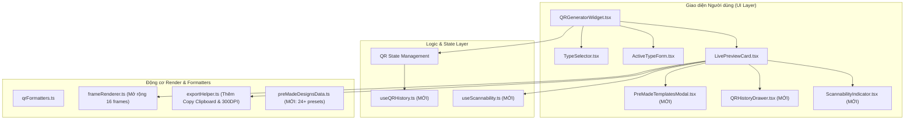

# Kế Hoạch Nâng Cấp Toàn Diện: ME-QR Clone Pro (Giống ME-QR Nhưng Xịn Hơn)

## Overview
Dự án **ME-QR Clone** hiện tại đã hoàn thành khung sườn vững chắc (100% Client-Side, 7 loại mã QR, 8 mẫu khung cơ bản, tùy biến hoa văn, màu sắc, gradient, logo và xuất file PNG/SVG/PDF). 
Mục tiêu của đợt nâng cấp **ME-QR Pro** là tái hiện trọn vẹn những điểm tinh túy nhất từ dữ liệu reverse-engineer gốc của ME-QR (`https://me-qr.com/vi`), đồng thời bổ sung các tính năng đột phá **vượt trội hơn bản gốc**:
1. **Không quảng cáo, không ép đăng ký tài khoản, không giới hạn lượt quét.**
2. **Bộ sưu tập 24+ Mẫu thiết kế chuyên nghiệp (Pre-made Templates Gallery)** chọn nhanh với 1 cú click.
3. **Mở rộng thư viện Khung (Frames)** từ 8 lên 16+ mẫu phong phú chuẩn vector.
4. **Bộ kiểm tra Quét thử thời gian thực (Live Scannability Engine)** bằng barcode reader ảo chạy client-side, tự động chấm điểm độ dễ quét và gợi ý sửa lỗi (Auto-Fix).
5. **Bộ nhớ lịch sử mã đã tạo (QR History)** lưu trữ an toàn 100% trong LocalStorage, xem lại và tải lại bất cứ lúc nào.
6. **Sao chép nhanh vào Clipboard (1-Click Copy Image)** để paste trực tiếp vào Photoshop, Figma, Word, Canva.

---

## Requirements

### Yêu cầu chức năng (Functional Requirements)
1. **Pre-made Templates Gallery (Mẫu phối màu & kiểu dáng có sẵn):**
   - Modal/Drawer hoặc Tab chọn trực quan gồm 24+ mẫu thiết kế tinh tuyển từ 68 mẫu gốc của ME-QR (Neon Cyber, Ocean Blue, Luxury Gold, Elegant Rose, Corporate Navy, Emerald Mint, Sunset Purple...).
   - Nhấn 1-click để áp dụng toàn bộ cấu hình: hoa văn, màu sắc, gradient, mắt quét và khung viền vào trình chỉnh sửa.
2. **Nâng cấp Thư viện Khung (Expanded Frames System):**
   - Mở rộng từ 8 khung hiện tại lên 16 kiểu khung đa dạng:
     - `ribbon-top`, `ribbon-bottom`, `hanging-sign`, `scan-phone`, `coupon-cutout`, `vintage-polaroid`, `bubble-talk`, `store-display`, `modern-card`, `minimal-border`, `circle-badge`, `double-line`, v.v.
   - Hỗ trợ đổi phông chữ CTA text: Roboto, Plus Jakarta Sans, Inter, Poppins, Montserrat.
3. **Bộ quét kiểm tra khả năng quét (Live Scannability / Readability Checker):**
   - Tích hợp bộ đọc QR Client-Side (`jsQR` hoặc native canvas analysis) để quét thử canvas ngay khi người dùng chỉnh màu/logo.
   - Hiển thị thanh đo chất lượng:
     - 🟢 *100% - Hoàn hảo (Scannable)*
     - 🟡 *70% - Cảnh báo độ tương phản thấp*
     - 🔴 *Không thể quét - Logo che quá lớn hoặc màu trùng nền*
   - Nút **"Tự động sửa lỗi" (Auto-Fix)**: Tự động điều chỉnh độ tương phản và nâng mức sửa lỗi lên `H` (30%).
4. **Quản lý Lịch sử Mã QR Cục bộ (Local QR History):**
   - Tự động lưu 20 mã QR gần nhất vào `LocalStorage` (dữ liệu payload, loại mã, thumbnail, timestamp).
   - Cho phép xem lại danh sách, click để tải lại ảnh hoặc tái sử dụng cấu hình thiết kế.
   - Nút "Xóa lịch sử" và "Tải toàn bộ (Export All)".
5. **Công cụ tiện ích Pro (Pro Utilities):**
   - Nút "Sao chép ảnh" (Copy to Clipboard) định dạng PNG để paste ngay vào tài liệu.
   - Nút "Reset về mặc định".
   - Tùy chọn xuất ảnh chuẩn in ấn 300 DPI với các kích cỡ in thực tế (Thẻ tên 5x5cm, Menu A5, Biển quảng cáo A3).

### Yêu cầu kỹ thuật & Phi chức năng (Non-Functional Requirements)
- **100% Client-Side:** Không dùng bất kỳ backend server hay database bên ngoài nào.
- **Tuân thủ quy chuẩn /cook & /ponytail:**
  - Giữ toàn bộ files < 200 dòng (module hóa rõ ràng).
  - Không thêm thư viện cồng kềnh, ưu tiên Canvas API gốc và React hooks thuần.
  - Zero TypeScript errors (`tsc -b`).
  - Unit tests bao phủ 100% các tiện ích mới.

---

## Architecture & Component Design

---

## Implementation Steps

### Giai đoạn 1: Dữ liệu Mẫu & Mở rộng Động cơ Khung (Templates & Frames)
1. Tạo `src/data/preMadeTemplatesData.ts`: Chọn lọc 24 bộ cấu hình thiết kế đẹp mắt nhất trích xuất từ dữ liệu gốc `pre-made-designs.json`.
2. Mở rộng `src/utils/frameRenderer.ts`: Bổ sung 8 mẫu khung mới (nâng tổng số lên 16 khung), tối ưu hóa thuật toán vẽ Canvas bo góc và căn chỉnh typography.
3. Cập nhật `src/data/framePresets.ts`: Bổ sung danh sách 16 mẫu khung kèm nhãn tiếng Việt trực quan.

### Giai đoạn 2: Bộ Quét Đánh Giá Khả Năng Quét Thử (Live Scannability Engine)
1. Cài đặt thư viện quét barcode gọn nhẹ `jsqr` (zero dependencies, < 30KB).
2. Xây dựng hook `src/hooks/useScannability.ts`: Quét thử canvas ngầm mỗi khi QR render xong (debounce 150ms).
3. Xây dựng component `src/components/generator/preview/ScannabilityIndicator.tsx`: Hiển thị thanh trạng thái quét được kèm nút **Auto-Fix**.
4. Viết unit test cho `useScannability` và thuật toán tính độ tương phản màu sắc.

### Giai đoạn 3: Thư Viện Mẫu Thiết Kế Sẵn (Pre-made Templates Gallery Modal)
1. Xây dựng component `src/components/generator/templates/PreMadeTemplatesModal.tsx`:
   - Lưới hiển thị các thẻ mẫu với thumbnail trực quan, phân loại (Công sở, Độc lạ, Tối giản, Mạng xã hội, Sang trọng).
   - 1-click chọn để tự động điền toàn bộ thông số màu sắc, khung, hoa văn vào state.
2. Thêm nút "✨ Khám phá 24+ Mẫu có sẵn" nổi bật tại phần đầu LivePreviewCard.

### Giai đoạn 4: Bộ Nhớ Lịch Sử Mã QR (Local QR History) & Tiện ích Sao Chép
1. Xây dựng hook `src/hooks/useQRHistory.ts`: Lưu trữ tối đa 20 mã QR gần nhất vào LocalStorage, xử lý dữ liệu ảnh thumbnail Base64.
2. Xây dựng component `src/components/generator/history/QRHistoryDrawer.tsx`: Drawer trượt hiển thị danh sách các mã đã tạo, hỗ trợ tải lại hoặc phục hồi cấu hình.
3. Cập nhật `src/utils/exportHelper.ts`: Bổ sung hàm `copyCanvasToClipboard(canvas)` sử dụng `navigator.clipboard.write([new ClipboardItem(...)])`.
4. Bổ sung nút "Sao chép ảnh" (Copy to Clipboard) vào `DownloadButtonGroup.tsx`.

### Giai đoạn 5: Tinh chỉnh Giao diện, Testing & Build Verification
1. Cập nhật `Navbar.tsx`: Thêm nút "Lịch sử tạo mã" và badge trạng thái.
2. Viết thêm unit tests trong `src/utils/frameRenderer.test.ts` và `src/utils/exportHelper.test.ts`.
3. Kiểm tra giới hạn số dòng toàn bộ file (< 200 dòng).
4. Chạy kiểm thử tự động `npm test` và kiểm tra build `npm run build`.

---

## TODO List

- [ ] **Giai đoạn 1: Templates Data & Frames Engine**
  - [ ] Tạo file `src/data/preMadeTemplatesData.ts` (24 bộ preset đa dạng phong cách).
  - [ ] Nâng cấp `src/utils/frameRenderer.ts` hỗ trợ 16 mẫu khung phong phú.
  - [ ] Cập nhật `src/data/framePresets.ts` với đầy đủ thumbnail và tên gọi.
- [ ] **Giai đoạn 2: Live Scannability Engine**
  - [ ] Cài đặt `jsqr` và `@types/jsqr`.
  - [ ] Viết `src/hooks/useScannability.ts` để đọc và phân tích pixel canvas.
  - [ ] Tạo component `src/components/generator/preview/ScannabilityIndicator.tsx`.
  - [ ] Tích hợp tính năng tự động sửa tương phản & nâng Error Correction (Auto-Fix).
- [ ] **Giai đoạn 3: Pre-made Templates Gallery UI**
  - [ ] Tạo `src/components/generator/templates/PreMadeTemplatesModal.tsx`.
  - [ ] Thêm nút mở bộ sưu tập mẫu thiết kế trên `LivePreviewCard.tsx`.
- [ ] **Giai đoạn 4: QR History & Clipboard Utility**
  - [ ] Viết `src/hooks/useQRHistory.ts` lưu mã tự động vào LocalStorage.
  - [ ] Tạo component `src/components/generator/history/QRHistoryDrawer.tsx`.
  - [ ] Viết hàm `copyCanvasToClipboard` trong `src/utils/exportHelper.ts`.
  - [ ] Bổ sung nút Copy ảnh vào `DownloadButtonGroup.tsx`.
- [ ] **Giai đoạn 5: Verification & Testing**
  - [ ] Viết unit tests mở rộng.
  - [ ] Kiểm tra line count mọi file < 200 dòng.
  - [ ] Chạy `npm test` (đạt pass 100%).
  - [ ] Chạy `npm run build` (0 lỗi TypeScript).

---

## Risk Assessment

| Rủi ro tiềm ẩn | Mức độ | Biện pháp giảm thiểu |
| :--- | :---: | :--- |
| Trình duyệt cũ không hỗ trợ `navigator.clipboard.write` (ảnh) | Thấp | Fallback sang tải file PNG tự động hoặc hiển thị thông báo toast thân thiện. |
| LocalStorage bị đầy nếu lưu quá nhiều ảnh thumbnail Base64 | Trung bình | Giới hạn tối đa 20 bản ghi; nén ảnh thumbnail xuống kích thước 120x120px chất lượng thấp trước khi lưu. |
| Hàm quét thử QR `jsQR` làm chậm giao diện khi người dùng kéo thanh trượt màu liên tục | Trung bình | Sử dụng debounce 150-200ms và chỉ quét khi canvas vẽ xong; chạy bất đồng bộ qua `requestAnimationFrame`. |
| Kích thước bundle tăng do thêm 16 khung và 24 templates | Thấp | Dữ liệu cấu hình là JSON thuần gọn nhẹ (< 15KB); không import ảnh raster thừa. |

---

## Success Criteria
1. Người dùng có thể click 1 chạm để áp dụng ngay 24+ mẫu thiết kế phối sẵn tuyệt đẹp.
2. Thư viện khung có 16 mẫu vector sắc nét bao gồm cả ribbon, coupon, signboard, polaroid.
3. Đồng hồ đo Scannability thời gian thực phản hồi chính xác trạng thái quét được với nút Auto-Fix hoạt động mượt mà.
4. Lịch sử tạo mã lưu trữ và hiển thị 20 mã gần nhất, xóa/tải lại tiện lợi không cần tài khoản.
5. Sao chép ảnh vào Clipboard chỉ với 1 click.
6. 100% tests đạt pass, build production 0 lỗi, toàn bộ file nguồn < 200 dòng.

